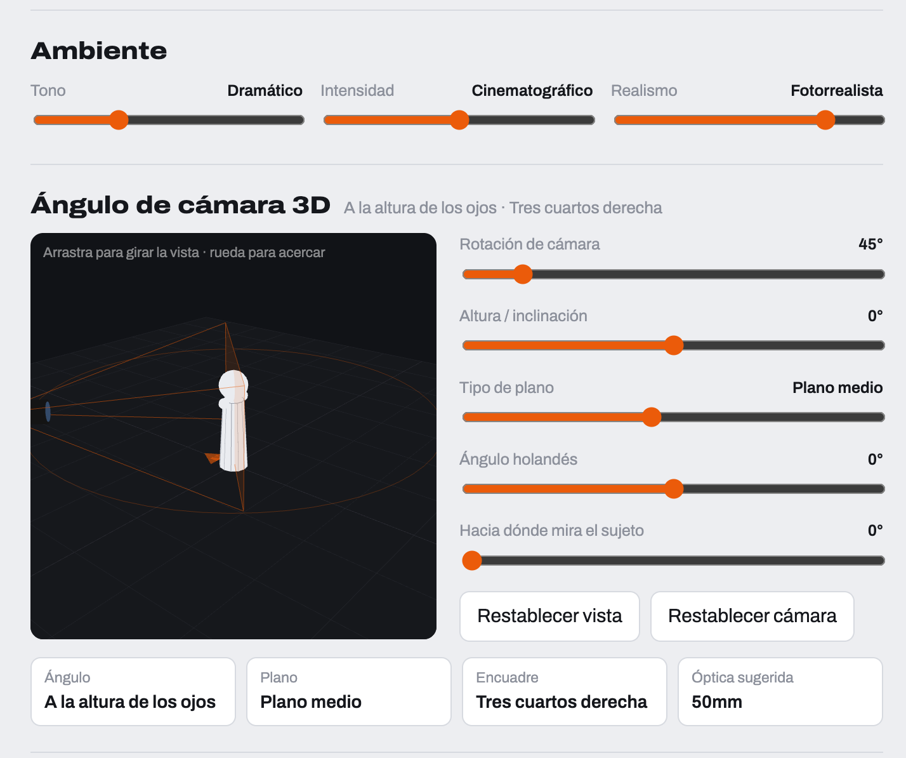

# Insumo · Cámara 3D en la dirección del plano (18.55)

Juan, 26-10-2026, ante esta captura de otra herramienta: «esto me pareció una pasada». No sabemos de qué herramienta es ni cómo está hecha. Se toma la idea, no el aspecto.

## Qué resuelve

Hoy el ángulo es una palabra de una lista: «picado», «tres cuartos». Cada modelo la interpreta a su manera, y entre los mismos «tres cuartos» puede haber 30° de diferencia. Con el 3D, el director coloca la cámara alrededor de un maniquí. Picasso traduce esa posición a palabras y a grados. Así el prompt dice exactamente lo que se ve, con la misma precisión numérica con la que trabajan los movimientos del catálogo (18.54).

## Qué tiene la referencia

- Un visor 3D: suelo en cuadrícula, maniquí en el centro, cámara con su pirámide de visión y un círculo de órbita. Se arrastra para girar la vista y con la rueda se acerca.
- Cinco controles:
  - rotación de la cámara (0–360°);
  - altura o inclinación;
  - tipo de plano;
  - ángulo holandés;
  - hacia dónde mira el sujeto.
- Botones «Restablecer vista» y «Restablecer cámara».
- Un resumen en cuatro tarjetas: Ángulo, Plano, Encuadre y Óptica sugerida (por ejemplo: a la altura de los ojos · plano medio · tres cuartos derecha · 50 mm).
- Encima, un bloque «Ambiente» con tres deslizadores: Tono, Intensidad y Realismo. **Este bloque no se toma.** Un continuo entre «dramático» y otra cosa no se traduce a un prompt preciso. En Picasso eso ya son decisiones discretas: tono (18.16), look (18.58) y pistas de realismo (18.16b y 18.16c).

## Propuesta para Picasso

### 1. Dos estados de cámara en vídeo

En imagen hay un solo estado. En vídeo hay dos, **inicio y final**, que son el encuadre y el ángulo de inicio y de final que ya define el §8. El visor enseña las dos cámaras unidas por una línea, y el **movimiento se deduce de la diferencia** entre ellas:

| Diferencia entre inicio y final | Movimiento propuesto (18.54) |
|---|---|
| Solo cambia la rotación | Arco a la derecha o a la izquierda de N°. Con 300° o más, órbita completa |
| Solo cambia el plano, acercándose con la cámara | Travelling adelante o atrás (dolly) |
| Solo cambia el plano, acercándose con la lente | Zoom lento o rápido, según la duración |
| Solo cambia la inclinación, desde la misma posición | Tilt arriba o abajo |
| Cambia la altura y se mantiene el sujeto encuadrado | Grúa arriba o abajo |
| Cambia la altura con la lente nivelada | Pedestal |
| Cambia hacia dónde mira el sujeto | No es cámara: se propone como acción del sujeto |
| Cambian dos o más cosas | Movimiento compuesto, con aviso «importante» en la revisión (18.48) |

El director puede aceptar el movimiento propuesto o elegir otro del catálogo. **Cuando hay ambigüedad entre cámara y lente**, un interruptor «acercar con: cámara | lente» decide entre dolly y zoom. Es el fallo más frecuente del modelo, y nunca se deja a su criterio.

### 2. De la posición al texto (valores por defecto, editables en YAML)

La rotación es relativa a hacia dónde mira el sujeto. Así, un giro del sujeto y un giro de la cámara no se confunden, que es justo el fallo del «plato giratorio».

| Rotación relativa | Texto |
|---|---|
| Hasta 15° | De frente |
| 15–60° | Tres cuartos (izquierda o derecha) |
| 60–120° | Perfil |
| 120–165° | Tres cuartos de espaldas |
| Más de 165° | De espaldas |

| Inclinación (positiva = cámara arriba) | Texto |
|---|---|
| 75° o más | Cenital |
| 30 a 75° | Picado |
| 10 a 30° | Ligeramente picado |
| −10 a 10° | A la altura de los ojos |
| −30 a −10° | Ligeramente contrapicado |
| −75 a −30° | Contrapicado |
| Menos de −75° | Contrapicado extremo |

| Plano | Óptica sugerida |
|---|---|
| Gran plano general | 24 mm |
| Plano general | 28–35 mm |
| Plano americano | 35 mm |
| Plano medio | 50 mm |
| Plano medio corto | 50–65 mm |
| Primer plano | 85 mm |
| Primerísimo primer plano | 100 mm |
| Detalle | Macro |

Coincide con la tabla de la 18.34. La óptica se sugiere, no se impone.

Con 5° o más, el ángulo holandés se escribe con sus grados y su lado.

**Línea que llega al prompt (en inglés, D7):** «Camera at eye level, 45° to the subject's right (three-quarter view), medium shot, 50mm lens, no dutch tilt.» En vídeo se añade la línea del final y la plantilla del movimiento, con sus negaciones.

### 3. Datos

El plano gana `camara_inicio` y `camara_final`, cada uno con estos campos:
- `rotacion`
- `inclinacion`
- `altura_m` (opcional)
- `distancia_m` (opcional)
- `plano`
- `holandes`
- `mira_sujeto`
- `acercar_con`

Los campos de texto que ya existen (encuadre y ángulo de inicio y final, óptica, movimiento) se rellenan desde ellos. Así **las plantillas no cambian** y un plano antiguo sin 3D sigue funcionando. Si el director edita a mano el texto, el 3D queda «desligado» hasta pulsar «Reconstruir desde la cámara», igual que el prompt editado a mano del §8.

### 4. Escala y escenario (segunda fase)

- El maniquí toma la **altura de la ficha** del personaje (18.53 y EVA, regla 8).
- Con varios personajes del reparto en el plano, un maniquí por cada uno y su lado de pantalla. De ahí sale el eje de 180° de la 18.38.
- Si la localización tiene planta o una imagen cenital (18.59), se usa como suelo del visor.

### 5. Interfaz

- Es un componente del frontend (Three.js con react-three-fiber) dentro de la pestaña Dirección.
- Usa los tokens de Picasso (paleta niebla/petróleo), no el naranja de la captura.
- No llama a ningún proveedor: es dirección pura y gratis (§0.4).
- «Explorar encuadres» (§8) puede partir de la cámara actual y variar ±30° en rotación e inclinación.

## Criterios de aceptación (borrador para el SDD)

1. Colocar la cámara a 45° a la derecha, a la altura de los ojos y en plano medio produce las cuatro tarjetas y la línea del prompt de arriba, sin llamar a ninguna API.
2. En vídeo, pasar la rotación de 45° a 105° con lo demás igual propone «arco a la derecha de 60°» con la plantilla del catálogo y su aviso de fallo típico.
3. Cambiar hacia dónde mira el sujeto no cambia el ángulo de cámara escrito en el prompt.
4. Un plano creado antes del 3D se abre con sus textos intactos y la cámara en «sin colocar».
